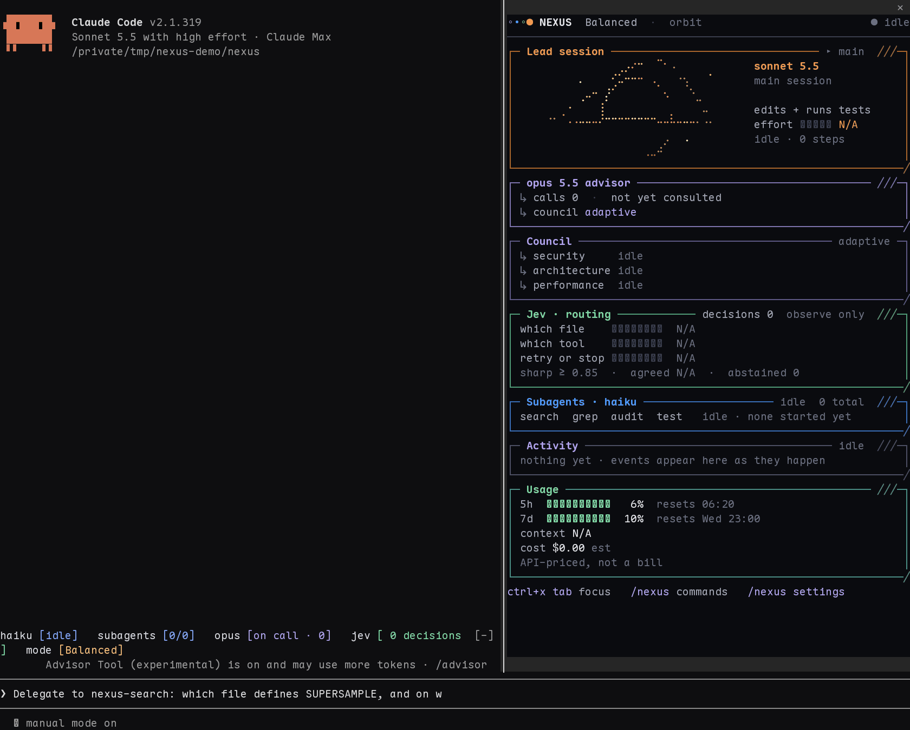
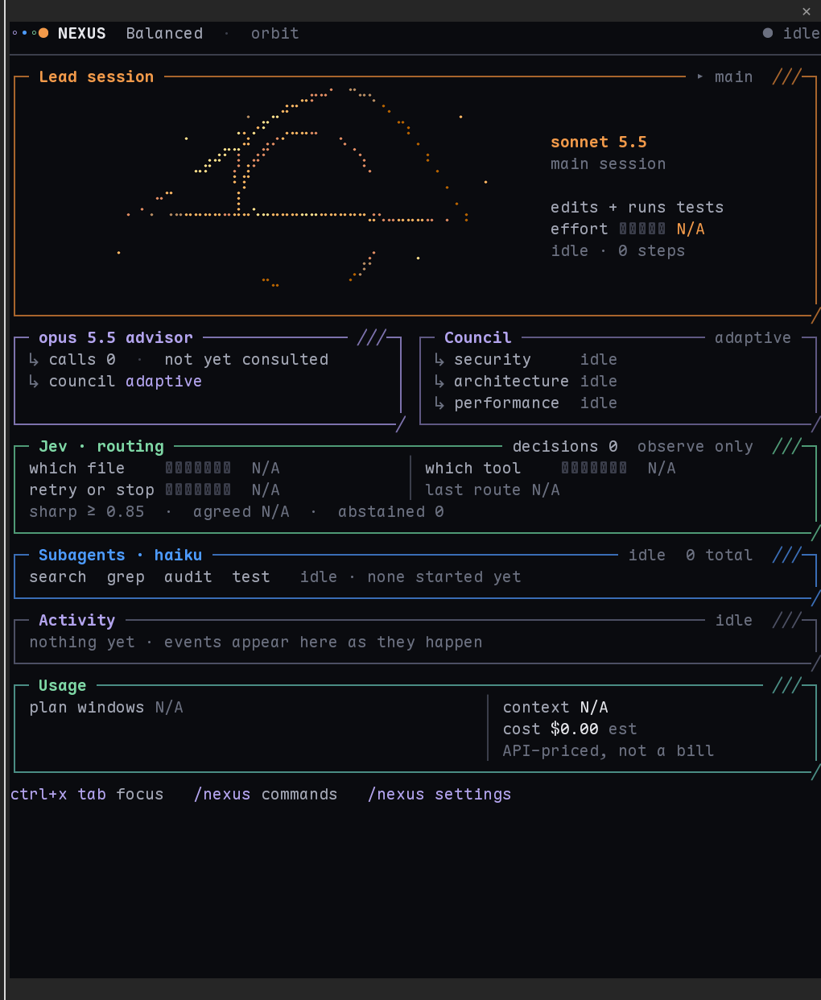
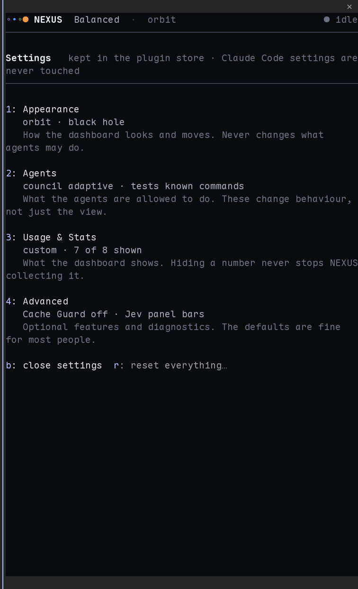

<div align="center">


### A terminal-native multi-agent command center for Claude Code

**NEXUS shows what your lead model, Haiku subagents, Opus advisor and reviewers are doing as they do it, in a dashboard docked beside your session.**

[Install](#install) · [Quick start](#quick-start) · [Orbit](#orbit) · [Agents](#agents) · [Settings](#settings-and-telemetry) · [Commands](#commands) · [Docs](#documentation)



<sub>The Orbit pane in a **real Claude Code 2.1.318 session**, docked beside the conversation, while two Haiku subagents run. Frames are screens captured from the live terminal about 1.6 seconds apart (so the black hole's slow drift looks jumpy here, and is smooth in the terminal); the numbers are the session's own. <a href="mod/nexus/docs/screenshots/live-pane-80.png">Full-size still</a> · <a href="mod/nexus/docs/screenshots/blackhole-before-after.png">black hole, v0.8.0 vs v0.8.1</a></sub>

</div>

## Install

```sh
claude plugin marketplace add muhzain05/Nexus && claude plugin install nexus@muhzain05 --scope user
```

That is two Claude Code commands in one line; nothing is downloaded or run beyond the plugin itself. Start a **new** Claude Code session in the fullscreen TUI (`"tui": "fullscreen"` in Claude Code's settings), then run **`/nexus`**.

<details>
<summary>From a local clone · the companion skill · upgrading from 0.7</summary>

```sh
git clone https://github.com/muhzain05/Nexus
claude plugin marketplace add ./Nexus && claude plugin install nexus@muhzain05 --scope user
```

The optional companion skill (setup help, and the four agent definitions for search, grep, audit and test) installs with:

```sh
npx skills add muhzain05/Nexus --skill nexus -g -a claude-code
```

The dashboard needs the plugin above; the skill alone does not draw anything. The **Test** agent also needs its definition (`nexus-test.md`) in `~/.claude/agents/`; see [the agents guide](mod/nexus/docs/test-agent.md).

**Upgrading:** `claude plugin update nexus@muhzain05`. If you used NEXUS before 0.8 your dashboard **stays on the Classic look** with the same settings; switch with `/nexus settings theme orbit`.

</details>

## Quick start

1. Open the dashboard: **`/nexus`**.
2. Ask for real work, for example *"map this repo with subagents, then summarise it"*, and watch the agents run.
3. Click the pane or press `ctrl+x tab` to focus it, then `1`-`9` to inspect an agent, `a` for the full activity tape, `s` for settings.
4. `/nexus doctor` checks the install; `/nexus-help` lists every command.

## What it does

| | |
| :--- | :--- |
| **See who is working** | The lead's real model and effort, every subagent as a row with its task, turns and time, the advisor's consultations, Council reviewers and Jev's routing answers. |
| **Know what it costs** | Context used and left, an API-priced session estimate, and your plan's 5-hour and weekly windows, all as Claude Code reports them. |
| **Stay in control** | Model modes, a four-section settings screen, per-agent inspection, and safety limits you can read ([Council](mod/nexus/docs/council-and-tool-routing.md), [Test agent](mod/nexus/docs/test-agent.md)). |

No terminal wrapper and no patched binary: it is a native Claude Code plugin, and your prompt, permissions and sessions work as before.

> **Honest by design.** Every number comes from Claude Code. What it does not report reads `N/A`, never `0`. Costs are **API-priced estimates**, not necessarily what a subscription is charged, and NEXUS does not guess per-agent cost.

## Orbit

Orbit is the 0.8 look: near-black, thin panels with an angled corner, and a slow black hole, drawn in fine Braille dots, for the Sonnet lead that moves only while work is running. It is built to sit in a split terminal, so it is designed for 60 to 100 columns and adapts above and below that.

<table>
<tr>
<td width="50%"></td>
<td width="50%"></td>
</tr>
<tr>
<td><sub>A live 84-column pane (half-screen).</sub></td>
<td><sub>Settings: Appearance, Agents, Usage &amp; Stats, Advanced (live).</sub></td>
</tr>
</table>

- **Animation:** Black hole (default), Classic orbit, or Off; Slow or Very slow. The black hole is a thin amber picture in three sizes that fit the pane, drawn in Unicode Braille dots; only its brightness moves, and only while work runs. **Art detail** (Auto or Simple) switches to plain `. : '` characters if your font shows boxes instead of dots. Reduced motion draws one still frame, and nothing redraws while the session is idle or the pane is closed.
- **Agent connections:** thin lines and marks show which agent was given which task and when its result came back, drawn only from events Claude Code reported (`/nexus settings agentLinks off` hides them; display only). [How to read them](mod/nexus/docs/dashboard.md#agent-connections)
- **Classic** is still there and unchanged: `/nexus settings theme classic`.
- More live stills: [62 columns](mod/nexus/docs/screenshots/live-pane-60.png) · [100](mod/nexus/docs/screenshots/live-pane-100.png) · [120](mod/nexus/docs/screenshots/live-pane-120.png) · [agents running](mod/nexus/docs/screenshots/live-agents-running.png) · [Agents settings](mod/nexus/docs/screenshots/live-settings-agents.png). Agent connections, live: [result returned](mod/nexus/docs/screenshots/live-flow-returned-84.png) · [delegating](mod/nexus/docs/screenshots/live-flow-delegating-84.png) · [Council running](mod/nexus/docs/screenshots/live-flow-council-running-84.png) · [62 columns](mod/nexus/docs/screenshots/live-flow-62.png) · [120](mod/nexus/docs/screenshots/live-flow-120.png). Rendered from sample data (not live): [a failure](mod/nexus/docs/screenshots/sample-alert.png), [the Full preset](mod/nexus/docs/screenshots/sample-full-preset.png).

## Agents

| Role | Model | What it does |
| :--- | :--- | :--- |
| **Lead** | Sonnet | Plans, edits and runs tests, and coordinates the rest. |
| **Search** | Haiku | Maps the repository: structure, entry points, build and test commands. Read-only. |
| **Grep** | Haiku | Finds definitions, references and call sites. Read-only. |
| **Audit** | Haiku | Checks the current change (type-check, tests, lint, a scan of the diff). Reports; never edits. |
| **Test** | Haiku | Runs the project's existing tests and reports what actually ran. Known test commands only. |
| **Advisor** | Opus | Reviews hard decisions when the lead consults it. Reads, never writes. |

NEXUS **watches** these roles; Claude Code decides when to use one, and several instances of a role can run at once. The Test agent's commands are checked by NEXUS against a per-runner allowlist on top of Claude Code's own permissions. That is a guard on what the agent may ask for, **not isolation**: your project's tests run with your permissions. [Details and limits](mod/nexus/docs/test-agent.md) · [Why only these roles](mod/nexus/docs/haiku-agents-benchmark.md)

### Council

At a review checkpoint the Opus advisor can call in read-only **Security**, **Architecture** or **Performance** reviewers. Adaptive (default) runs the one it picks, On runs all three, Off keeps the single advisor. Reviewers cannot write, run commands or read secrets. [How it works](mod/nexus/docs/council-and-tool-routing.md)

### Jev

An optional router that answers small questions (which file, which tool, retry or stop). It is **observe-only by default**: its answers are drawn, nothing changes. [Jev](mod/nexus/docs/jev.md) · [Cache Guard](mod/nexus/docs/cache-guard.md) (optional, off by default)

## Settings and telemetry

`/nexus settings` opens four plain sections, each showing its default and what the setting does:

| Section | What is in it |
| :--- | :--- |
| **Appearance** | Theme, animation and speed, layout width, density, reduced motion |
| **Agents** | Council mode, whether the Test agent may run tests, stronger-mode suggestions. *These change what agents may do.* |
| **Usage & Stats** | What to show: Minimal, Standard (default), Full or Custom; tokens, costs, context, times, routing, activity, warnings |
| **Advanced** | Jev panel, Cache Guard, diagnostics, export, reset |

What the dashboard **shows** and what agents are **allowed** to do are kept apart: switching theme or hiding a number never changes a permission, and hiding a number never stops NEXUS collecting it. Failures and limits at 90% are always shown. [Telemetry guide](mod/nexus/docs/telemetry.md)

## Commands

| Command | What it does |
| :--- | :--- |
| **`/nexus`** | Open the dashboard |
| **`/nexus settings`** | Settings; `/nexus settings <section>`, `<key> <value>`, `reset <section\|all>`, `export` |
| **`/nexus-mode`** | Choose the model mode (Balanced, Deep, Max) |
| **`/nexus agents`**, **`/nexus inspect <n>`** | List and inspect this session's agents |
| **`/nexus usage`** | Context, cost estimate, plan usage, tokens |
| **`/nexus council`**, **`/nexus-jev`**, **`/nexus cache`** | Council, Jev routing, Cache Guard |
| **`/nexus doctor`** | Check the install |
| **`/nexus-help`**, **`/nexus-about`** | Reference and introduction |

## Documentation

- [Dashboard, agents and model modes](mod/nexus/docs/dashboard.md)
- [Telemetry and cost estimates](mod/nexus/docs/telemetry.md)
- [The Test agent](mod/nexus/docs/test-agent.md) · [Council](mod/nexus/docs/council-and-tool-routing.md) · [Jev](mod/nexus/docs/jev.md) · [Cache Guard](mod/nexus/docs/cache-guard.md)
- [Compatibility](mod/nexus/docs/compatibility.md) · [Troubleshooting and uninstall](mod/nexus/docs/troubleshooting.md)
- [Changelog](CHANGELOG.md) · [Acknowledgments](ACKNOWLEDGMENTS.md)

## Contributing

Bug reports, ideas and pull requests are welcome: start with [CONTRIBUTING.md](CONTRIBUTING.md). Looking for a first task? See the [`good first issue`](https://github.com/muhzain05/Nexus/labels/good%20first%20issue) label. Security problems go through [private reporting](SECURITY.md), not a public issue.

## License

[MIT](LICENSE) © Muhammad Zain. Third-party credits are in [ACKNOWLEDGMENTS.md](ACKNOWLEDGMENTS.md).

---

<div align="center">


</div>
