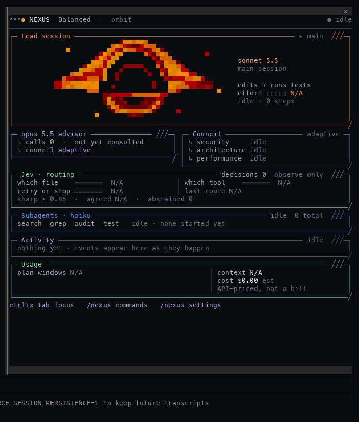
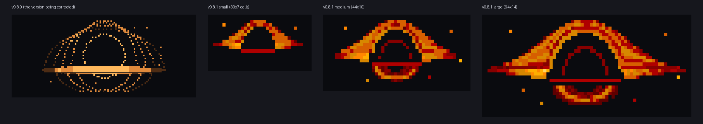
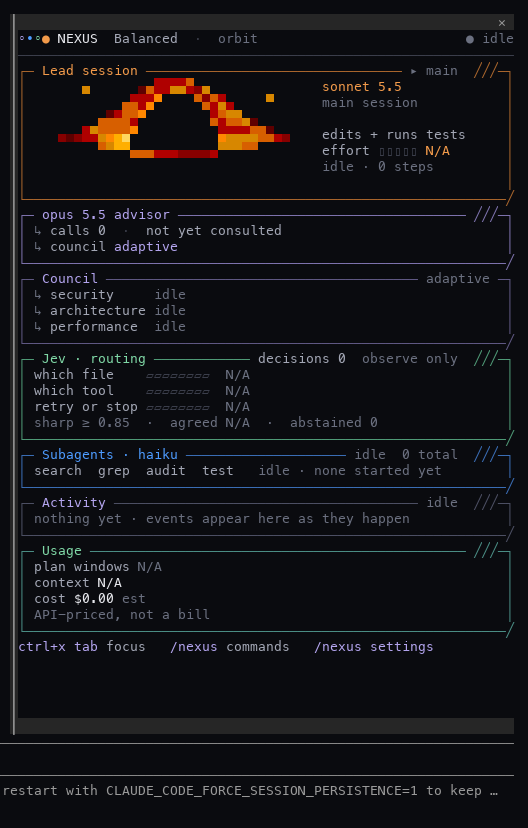

# The NEXUS dashboard

[← Back to the README](../../../README.md)

**① Header.** The NEXUS mark moves for as long as a turn runs, agents included, and settles when it ends. The **⚙** opens settings.

**② Advisor.** The advisor model (Opus 5.5, or Fable 5.1 in the stronger modes), when it was last consulted, how often and for how long, and how much context it read. It shows *Awaiting consultation.* until the first call.

**③ Lead.** The model that actually answered, its effort, and whether it's working, idle or waiting on you.

**④ Jev.** Routing answers as green bars: bright when **sharp** (≥ 0.85), muted when **split**.

**⑤ Agents.** One fixed card per agent instance (`search#1`, `grep#1`, …), each with a small orbit in its corner and its state on the bottom row. Agents outside your configured set are marked *fallback*.

**⑥ Cache Guard and USAGE.** The optional cache keeper, then your plan's rate-limit windows.

**⑦ Bottom left.** Context used and left, the session estimate, the running models and the current mode.

 

## Orbit, the 0.8 look

Orbit is the default for new installs. If you used NEXUS before 0.8 you stay on **Classic** until you choose otherwise (`/nexus settings theme orbit`); switching either way is live and changes nothing about what agents may do.

A real Claude Code session, the pane about 84 columns wide.

- **Header:** wordmark, mode, theme, the lead's state, context and Cache Guard when they are shown.
- **Lead:** the Sonnet session. At widths where it fits, the pixel-art black hole sits at the left and the model name, effort and state sit beside it; narrower, the words go under a smaller picture.
- **Advisor, Council and Jev:** the advisor (calls, last consultation, what it read and how long it took), the Council reviewers with timings and findings, and Jev's routing answers, labelled *observe only* or *active*. In wide panes the advisor and Council sit beside the lead; otherwise side by side under it. No panel is stretched to fill space.
- **Subagents:** one row per instance, running first: task, turns, state and time. Any number of instances of any role (`search`, `grep`, `audit`, `test`); beyond six the rest are counted (`+3 more`). A long task name shrinks first; the state and time never do.
- **Activity:** a compact tape (agent started, finished or failed, advisor consulted, Council, Jev, test results). Repeats are dropped. Press `a` for the full tape.
- **Usage:** plan windows, context and, depending on the preset, cost and tokens.
- **Alerts:** a failed agent, a failed Council reviewer, context or a plan window at 90%, or Jev down appear under the header whatever you hide. Amber warnings at 70% can be turned off.

### The black hole

It is drawn in square pixels (a half block is a square at a terminal's usual 1:2 cell shape) with a fixed eight-step dark-red-to-amber palette whose colours are exact xterm-256 entries, so a 256-colour terminal shows the same picture. Dark areas (the horizon, the sky) are cells with no colour at all, so a terminal without colour still shows the horizon as empty (set `NO_COLOR` and it draws in shades).

Three compositions are tuned separately, not one picture scaled: **small** (30×7 cells: horizon, dome and a thin disk), **medium** (44×10: adds the inner arc, the lensed bowl and particles) and **large** (64×14: adds contour bands and disk streaks). The largest that fits is used; none is stretched.

Motion is slow and only changes brightness, by at most one palette step: a warm wave along the disk, a slower ripple through the dome, a gentle twinkle of the particles. Which pixels are lit never changes, so the horizon and the silhouette are fixed. One cycle is 24 seconds (36 on *Very slow*) in 60 frames, drawn about 2.5 times a second while work runs, and not at all when the session is idle, the pane is closed or the session has ended. Reduced motion draws one still frame and runs no timer.

### Width

Claude Code caps a docked pane at 45% of the terminal, so a 100-column Orbit needs a terminal about 220 columns wide; the panes in the screenshots are 62, 84, 100 and 120 columns. Three layouts: from 112 columns the lead sits beside the advisor and Council; from 68 it stacks with the advisor and Council side by side; narrower it trims. Below 40 columns, or inline, it falls back to a one-line-per-agent list. If the dashboard would be taller than the pane, the blank rows between groups go first, so the bottom is never what is cut off.

## Motion that means something

Every animation starts from a real event and stops when it ends. When nothing is happening, NEXUS doesn't redraw at all, and reduced motion swaps every animation for a still frame.

  

 
The advisor runs inside an API request, so Claude Code reports it only once that request ends. Its animation plays then, marked "reported just now", and never pretends to be live.

## Inspect any agent

Click the dashboard (or press `ctrl+x tab`) and press `1`–`9`, or type `/nexus inspect search#2`. You get the agent's task, state and run time, turns over its limit, tool calls, files touched, recent actions, tokens, and its final answer.

## Settings, help and onboarding

<table>
<tr>
<td width="50%"></td>
<td width="50%"></td>
</tr>
<tr>
<td align="center"><b>⚙ Settings</b>: layout, motion, telemetry, log rows, Jev, Cache Guard. Kept in the plugin's own store; your Claude Code settings are never touched.</td>
<td align="center"><b>/nexus-help</b>: every command and shortcut, drawn in the transcript</td>
</tr>
</table>

 <b>/nexus-about</b>: a first-run guide with a three-step quick start

## Every command

| Command | What it does |
|---|---|
| `/nexus` | open the dashboard · `close` to close it |
| `/nexus layout auto\|full\|compact\|minimal` | switch layouts (auto picks by width) |
| `/nexus settings [section \| key value]` | open settings (`appearance`, `agents`, `usage`, `advanced`), or change one |
| `/nexus settings reset <section\|all>` | back to the defaults; `all` asks you to confirm |
| `/nexus settings export` | print your preferences |
| `/nexus width max\|40-200\|wider\|narrower` | pane width (a width you drag by hand wins) |
| `/nexus back` | back to the diagram from a detail view |
| `/nexus agents` · `/nexus inspect <n\|label>` | list agents · open one |
| `/nexus usage` | context, cost estimate, plan usage, tokens by model |
| `/nexus-mode [balanced\|deep\|max\|default\|status]` | reasoning mode for this session |
| `/nexus-jev [status\|active\|observe\|off\|calibrate]` | Jev routing |
| `/nexus cache [on\|off]` | Cache Guard |
| `/nexus doctor` | check the install and integrations |
| `/nexus-help` · `/nexus-about` | reference · introduction |

**Keys, with the dashboard focused:** `1`–`9` inspect · `s` settings · `a` activity (Orbit) · `b` back · `ctrl+x ←/→` resize · `ctrl+x x` close · `esc` back to the prompt.

## Model modes in detail

| Mode | Lead | Advisor | When |
|---|---|---|---|
| **Balanced** *(default)* | Sonnet 5.5 · high | Opus 5.5 | everyday work |
| **Deep Engineering** | Opus 5.5 · xhigh | Fable 5.1 | refactors, tricky bugs, architecture |
| **Maximum Reasoning** | Fable 5.1 · max | Fable 5.1 | the hardest problems |

`/nexus-mode` switches the lead for this session only. Before a hard-looking prompt, NEXUS can suggest a stronger mode in a dialog, and **it never switches without your yes**. Fable bills to usage credits.

An advisor must rank at least as high as the lead, and Claude Code only lets an advisor change by relaunching the conversation. So when a mode needs a different advisor, NEXUS prints a one-line relaunch command that applies just to that session. Your saved defaults are never edited.
